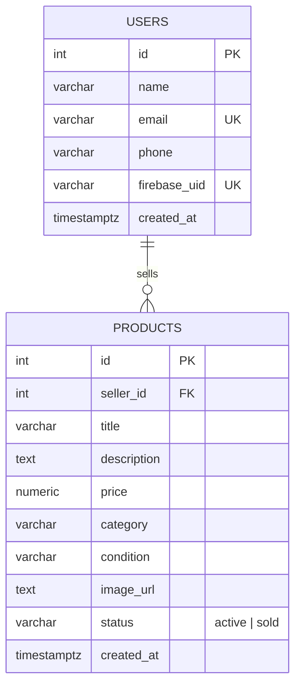

# Bid.ai

Android marketplace app (Kotlin, Jetpack Compose, MVVM) with a Node.js + PostgreSQL REST backend.
Screens: **Login / Sign up → Home (browse, search, filter) → One-Click Sell**.

## Tech stack

| Layer | Tech |
|---|---|
| Android | Kotlin, Jetpack Compose + Material 3, MVVM (ViewModel + StateFlow), Navigation Compose, Retrofit/OkHttp/Gson, Coil, min SDK 33 |
| Backend | Node.js 18+, Express, `pg`, jose (Firebase token verification), multer (image upload) |
| Database | PostgreSQL |
| Auth | Firebase Authentication (email/password). The app sends the Firebase ID token as `Authorization: Bearer <token>`; the API verifies it against Google's public keys. Profiles (name, phone) live in Postgres |
| Tests | Node `node:test` integration tests on a real embedded Postgres; JUnit for validators |

## Run it

### 1. Backend

```bash
cd backend
npm install
npm run dev:local   # Postgres + API together, no install needed -> http://localhost:3000
npm test            # integration tests
```

Already have Postgres? `cp .env.example .env`, set `DATABASE_URL`, then `npm start` (tables are created automatically).

Or with Docker: `docker compose up --build` (API + Postgres on :3000).

> **The app needs the backend running.** If you see "Can't reach the server at http://10.0.2.2:3000/", start the backend first. `10.0.2.2` only works from the Android *emulator*; for a physical phone rebuild with `-PAPI_BASE_URL=http://<your-pc-lan-ip>:3000/` (same Wi-Fi) or a deployed URL.

### 2. Android app

Open the project in Android Studio and run, or from a terminal:

```bash
./gradlew assembleDebug                                   # emulator (talks to http://10.0.2.2:3000)
./gradlew assembleDebug -PAPI_BASE_URL=https://your-api/  # physical device / deployed backend
```

APK: `app/build/outputs/apk/debug/app-debug.apk`. For a physical phone on the same Wi-Fi use your PC's LAN IP, e.g. `-PAPI_BASE_URL=http://192.168.1.10:3000/`.

## API

Base URL `http://localhost:3000`. All routes except `/health` require `Authorization: Bearer <Firebase ID token>`. Errors: `{ "error": "msg", "fields": { "email": "msg" } }`.

| Method | Endpoint | Auth | Description |
|---|---|---|---|
| POST | `/api/auth/signup` | Bearer | `{name,phone}` (email comes from the token) → `201 {user}` (`200` if already created); `400` validation, `409` email taken |
| POST | `/api/auth/login` | Bearer | → `200 {user}`; `401` bad token or no profile |
| GET | `/api/products?search=&category=&brand=&page=&limit=` | Bearer | Active listings, newest first |
| GET | `/api/products/brands?category=` | Bearer | Brands of active listings (Home filter chips) |
| GET | `/api/products/mine` | Bearer | Caller's listings (any status) |
| GET | `/api/products/categories` | Bearer | Allowed categories & conditions |
| GET | `/api/products/:id` | Bearer | One listing |
| POST | `/api/products` | Bearer | **Sell.** multipart: `title, price, category` + optional `description, condition, brand, productType, sellerType (vendor|individual), location, images` (up to 5 files) → `201 {product}` |
| PATCH | `/api/products/:id/sold` | Bearer | Mark own listing sold |
| DELETE | `/api/products/:id` | Bearer | Delete own listing |
| GET | `/health` | – | Liveness |

Optional demo listings that mirror the Home design: `cd backend && npm run seed` (needs the database running; no photos).

Postman: import `postman/Bidai.postman_collection.json` (set the `idToken` variable to a Firebase ID token; see the collection description).

## ER diagram



## Flow diagram


## Architecture

```
app/src/main/java/com/example/bidai
├── data/        model • remote (Retrofit, Firebase-token interceptor) • repository (Firebase Auth + API)
├── ui/          auth • home • sell • navigation • components • theme   (Screen + ViewModel per feature)
└── util/        Validators, price formatting
backend/src      app.js • routes/ • middleware/auth.js • schema.sql
```

Screen → ViewModel (immutable `UiState` in a `StateFlow`) → Repository → Retrofit. Network failures are mapped once, in `safeApiCall`, to a user-readable `AppResult.Failure`.

## Notes

- The UI is implemented from the frame sizes provided (Login/Sign up 390×844, Home, Sell) with a consistent design system in `ui/theme`; layouts are width-adaptive (adaptive grid, width-capped forms, IME-aware scrolling).
- Cleartext HTTP is enabled so the emulator/LAN backend works; use HTTPS in production.
- Firebase Authentication holds the credentials and refreshes ID tokens; the API never sees passwords. Set `FIREBASE_PROJECT_ID` (default `bidai-e8512bf5`) if you use another project.
