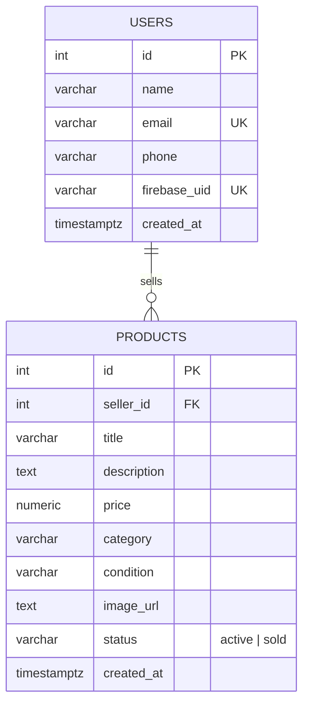
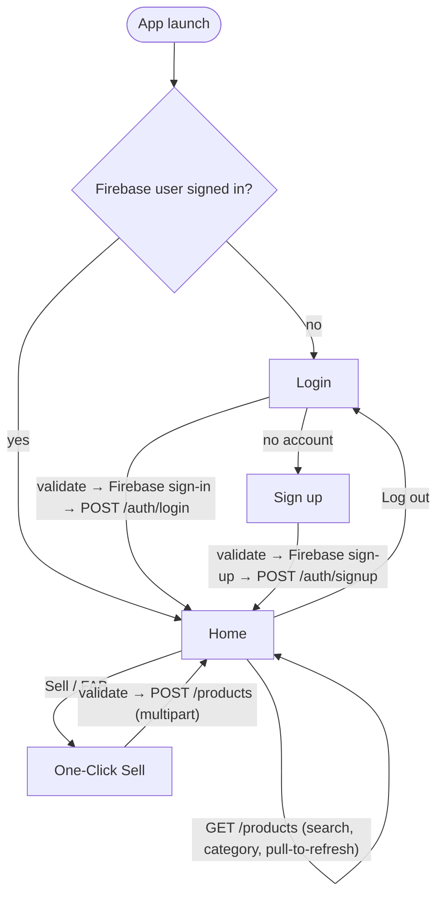

# Bid.ai

An Android marketplace app built with Kotlin and Jetpack Compose, backed by a Node.js + PostgreSQL REST API.

**Core flow:** Login / Sign up → Home (browse, search, filter) → One-Click Sell

---

## Table of Contents

- [Tech Stack](#tech-stack)
- [API Endpoints](#api-endpoints)
- [Postman Testing](#postman-testing)
- [ER Diagram](#er-diagram)
- [Flow Diagram](#flow-diagram)

---

## Tech Stack

| Layer | Technologies |
|---|---|
| **Android** | Kotlin, Jetpack Compose, Material 3, MVVM (ViewModel + StateFlow), Navigation Compose, Retrofit, OkHttp, Gson, Coil |
| **Backend** | Node.js 18+, Express, `pg`, `jose` (Firebase token verification), `multer` (image upload) |
| **Database** | PostgreSQL |
| **Authentication** | Firebase Authentication (email/password) with ID tokens sent as `Authorization: Bearer <token>`; user profiles stored in PostgreSQL |
| **Testing** | Node `node:test` integration tests (embedded PostgreSQL), JUnit |

---

## API Endpoints

**Base URL:** `http://localhost:3000`

All routes except `/health` require the header `Authorization: Bearer <Firebase ID token>`.

**Error format:**

```json
{ "error": "message", "fields": { "email": "message" } }
```

| Method | Endpoint | Auth | Description |
|---|---|---|---|
| `POST` | `/api/auth/signup` | Bearer | Create a profile from `{ name, phone }` (email is taken from the token). Returns `201 { user }`, or `200` if it already exists. Errors: `400` validation, `409` email taken |
| `POST` | `/api/auth/login` | Bearer | Authenticate and return `200 { user }`. Errors: `401` invalid token or missing profile |
| `GET` | `/api/products?search=&category=&brand=&page=&limit=` | Bearer | List active products, newest first |
| `GET` | `/api/products/brands?category=` | Bearer | List brands of active products (Home filter chips) |
| `GET` | `/api/products/mine` | Bearer | List the caller's own products (any status) |
| `GET` | `/api/products/categories` | Bearer | List allowed categories and conditions |
| `GET` | `/api/products/:id` | Bearer | Get a single product |
| `POST` | `/api/products` | Bearer | Create a listing (`multipart/form-data`). Required: `title`, `price`, `category`. Optional: `description`, `condition`, `brand`, `productType`, `sellerType` (`vendor` \| `individual`), `location`, `images` (up to 5). Returns `201 { product }` |
| `PATCH` | `/api/products/:id/sold` | Bearer | Mark own listing as sold |
| `DELETE` | `/api/products/:id` | Bearer | Delete own listing |
| `GET` | `/health` | None | Liveness check |

---

## Postman Testing

Import the collection from [`postman/Bidai.postman_collection.json`](postman/Bidai.postman_collection.json) and set the `idToken` collection variable to a valid Firebase ID token.

---

## ER Diagram



---

## Flow Diagram


