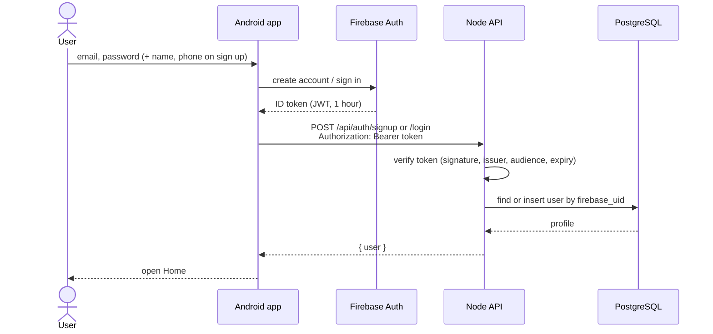
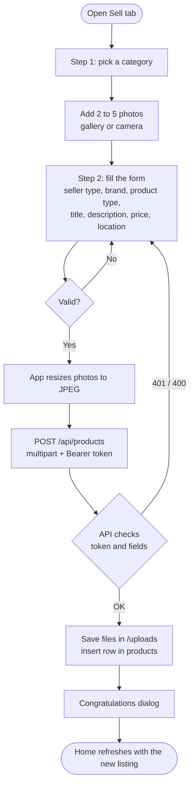
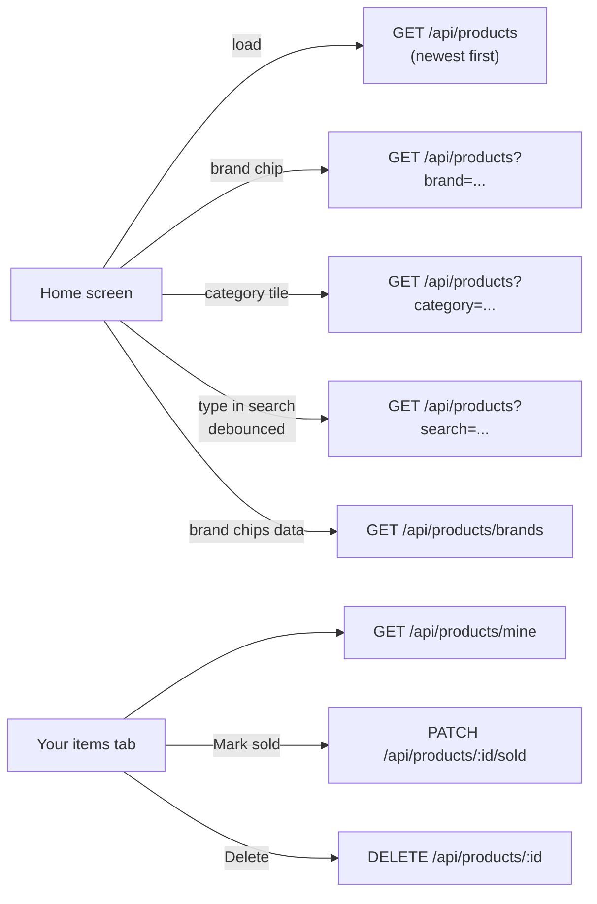
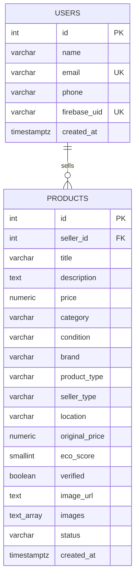

# Bid.ai – Technical Documentation

A marketplace app: browse listings, sell items with photos. Firebase handles **sign-in only**; everything else runs on our own Node.js + PostgreSQL API.

> Diagrams are written in Mermaid. They render on GitHub, in VS Code (Markdown Preview Mermaid Support) and in Android Studio's Markdown preview with the Mermaid plugin.

---

## 1. Tech stack

| Layer | Technology |
|---|---|
| Mobile app | Kotlin 2.4, Jetpack Compose + Material 3, MVVM (ViewModel + StateFlow), Navigation Compose |
| App networking | Retrofit 2.11, OkHttp 4.12, Gson, Coil (image loading) |
| Authentication | Firebase Authentication (Email/Password), Firebase BoM 35 |
| Backend API | Node.js 24, Express 4, multer (photo upload), jose (verifies Firebase ID tokens) |
| Database | PostgreSQL (`pg` driver) |
| Storage | Photos saved on the API server in `/uploads` |
| Testing | `node:test` integration tests (backend), JUnit (app), Postman collection |
| Dev tooling | Android Studio, Gradle (AGP 9), embedded Postgres for local dev, Docker Compose |
| Min Android | Android 13 (API 33) |

**Why this split:** Firebase stores the passwords and issues a signed ID token. The app sends it as `Authorization: Bearer <token>`; the API checks the signature against Google's public keys (no service account needed) and looks up the user by Firebase `uid`.

---

## 2. Flow diagram

### 2.1 Sign up / log in



If the profile call fails during sign up, the app deletes the new Firebase account so the user can retry.

### 2.2 Selling an item



### 2.3 Browsing



---

## 3. ER diagram



- One user sells many products. Deleting a user deletes their products (`ON DELETE CASCADE`).
- `status` is `active` or `sold`. `seller_type` is `individual` or `vendor`. `condition` is `new`, `like_new` or `used`.
- `price > 0` and `eco_score` is 0–100 (database checks).
- `original_price`, `eco_score` and `verified` come from Bid.ai's inspection, not from the seller.
- `images` holds up to 5 photo paths; `image_url` is the first one (kept for older clients).
- Categories (15 fixed values such as Cars, Mobiles, Real Estate) live in code, not in a table.
- Passwords are **not** stored here; they live in Firebase.

---

## 4. API endpoints

Base URL: `http://localhost:3000` (emulator uses `http://10.0.2.2:3000`).
All `/api/*` calls need `Authorization: Bearer <Firebase ID token>`. Errors look like `{ "error": "...", "fields": { "field": "..." } }`.

| Method | Path | Auth | Purpose | Success |
|---|---|---|---|---|
| GET | `/health` | none | Health check | 200 `{status:"ok"}` |
| POST | `/api/auth/signup` | token | Create the profile after Firebase sign up. Body: `{name, phone}`. Safe to repeat | 201 `{user}` (200 if it already exists) |
| POST | `/api/auth/login` | token + profile | Returns the caller's profile | 200 `{user}` |
| GET | `/api/products/categories` | token + profile | Categories and conditions | 200 `{categories, conditions}` |
| GET | `/api/products` | token + profile | Active listings, newest first. Query: `search`, `category`, `brand`, `page`, `limit` (max 50) | 200 `{page, limit, products}` |
| GET | `/api/products/brands` | token + profile | Brands of active listings. Query: `category` | 200 `{brands}` |
| GET | `/api/products/mine` | token + profile | The caller's own listings (any status) | 200 `{products}` |
| GET | `/api/products/:id` | token + profile | One listing | 200 `{product}` / 404 |
| POST | `/api/products` | token + profile | Create a listing (`multipart/form-data`) | 201 `{product}` / 400 |
| PATCH | `/api/products/:id/sold` | token + profile | Mark own listing sold | 200 `{product}` / 404 |
| DELETE | `/api/products/:id` | token + profile | Delete own listing | 204 / 404 |

**Create listing fields:** `title` (3–120, required), `price` (> 0, required), `category` (one of 15, required), `condition` (`new`/`like_new`/`used`), `description` (≤ 2000), `brand`, `productType`, `sellerType` (`individual`/`vendor`), `location`, and `images` (up to 5 files, image only, 5 MB each).

**Status codes:** 400 validation failed · 401 missing/invalid/expired token or no profile · 404 not found (or not yours) · 409 email already registered.

**Product JSON:**
```json
{
  "id": 12, "title": "Honda City 2018", "description": "...", "price": 650000,
  "category": "Cars", "condition": "used", "brand": "Honda", "productType": "Sedan",
  "sellerType": "individual", "location": "Bengaluru",
  "originalPrice": null, "ecoScore": null, "verified": false,
  "imageUrl": "http://.../uploads/....jpg", "images": ["http://.../uploads/....jpg"],
  "status": "active", "createdAt": "2026-10-18T09:00:00.000Z",
  "seller": { "id": 3, "name": "Asha Verma" }
}
```

---

## 5. Testing with Postman

File: [`postman/Bidai.postman_collection.json`](../postman/Bidai.postman_collection.json) — import it in Postman (Import → File). Every request has test scripts.

1. Start the API: `cd backend && npm run dev:local` (embedded Postgres + API on port 3000).
2. In the collection variables set `firebaseApiKey` (Firebase console → Project settings → Web API key, also `current_key` in `app/google-services.json`), `email` and `password`.
3. Run **0. Firebase → Sign up** (first time) or **Sign in**. It saves the token into `{{idToken}}`; every other request uses it automatically. Tokens last 1 hour, so sign in again when you get a 401.
4. Run **1. Auth → Signup** once to create the profile.
5. Run **2. Products** top to bottom. *Create* saves `{{productId}}`, which *Detail*, *Mark sold* and *Delete* then use. Attach photos in the `images` field of *Create*.

Automated backend tests (no Firebase needed, uses locally signed tokens): `cd backend && npm test`.

---

## 6. Project layout

```
Bidai/
├── app/                  Android app (Compose)
│   └── src/main/java/com/example/bidai/
│       ├── data/         model, remote (Retrofit), repository
│       ├── ui/           auth, home, sell, items, chat, components, navigation, theme
│       └── util/         validators and formatters
├── backend/              Node.js + Express API
│   ├── src/              app.js, routes/, middleware/, schema.sql
│   ├── scripts/          dev server, dev database, seed data
│   └── test/             integration tests
├── postman/              Postman collection
└── docs/                 this document
```
